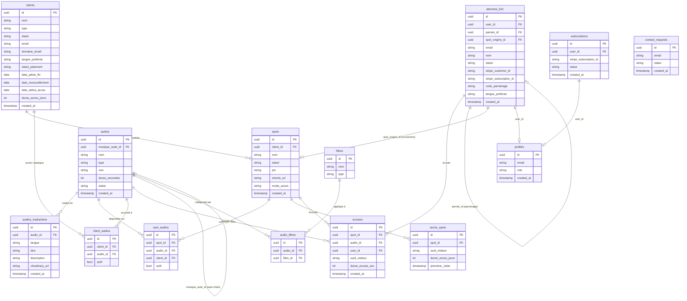

# Schéma ERA — Base de données Spots Zen

> Généré le 12/10/2026 · Source : `src/integrations/supabase/types.ts`

## Diagramme de relations

## Description des tables

### Cœur B2B
| Table | Rôle |
|---|---|
| `clients` | Établissements partenaires (hôtels, spas, cliniques…) |
| `spots` | Points d'accès physiques (totem, borne) avec QR/NFC |
| `spot_audios` | Catalogue d'audios activés sur un spot donné |
| `client_audios` | Catalogue global accordé à un client B2B |
| `acces_spots` | Suivi des visites par UUID visiteur (cookie) |

### Cœur Audio
| Table | Rôle |
|---|---|
| `audios` | Catalogue maître des méditations/musiques |
| `audios_traductions` | Titre, description et URL Cloudinary par langue |
| `filtres` | Tags de filtrage (type, voix, durée…) |
| `audio_filtres` | Association audio ↔ filtre |

### Cœur B2C
| Table | Rôle |
|---|---|
| `abonnes_b2c` | Abonnés particuliers (Stripe + parrainage) |
| `subscriptions` | Abonnements Stripe actifs |
| `profiles` | Profils auth (rôle admin ou user) |
| `ecoutes` | Historique d'écoutes (analytics) |
| `contact_requests` | Demandes de contact formulaire |

## Fonctions SECURITY DEFINER (RLS)

| Fonction | Rôle |
|---|---|
| `is_admin()` | Vérifie `profiles.role = 'admin'` pour `auth.uid()` |
| `get_spot_public()` | Données spot sans RLS (QR public) |
| `verify_spot_pin()` | Vérification PIN côté serveur |
| `get_spot_catalog()` | Catalogue audio d'un spot |
| `get_audio_public()` | Métadonnées audio publiques |
| `register_spot_visit()` | Enregistre une visite `acces_spots` |
| `handle_new_user()` | Crée le profil à l'inscription |
| `link_abonne_on_signup()` | Lie l'abonné B2C à son compte auth |
