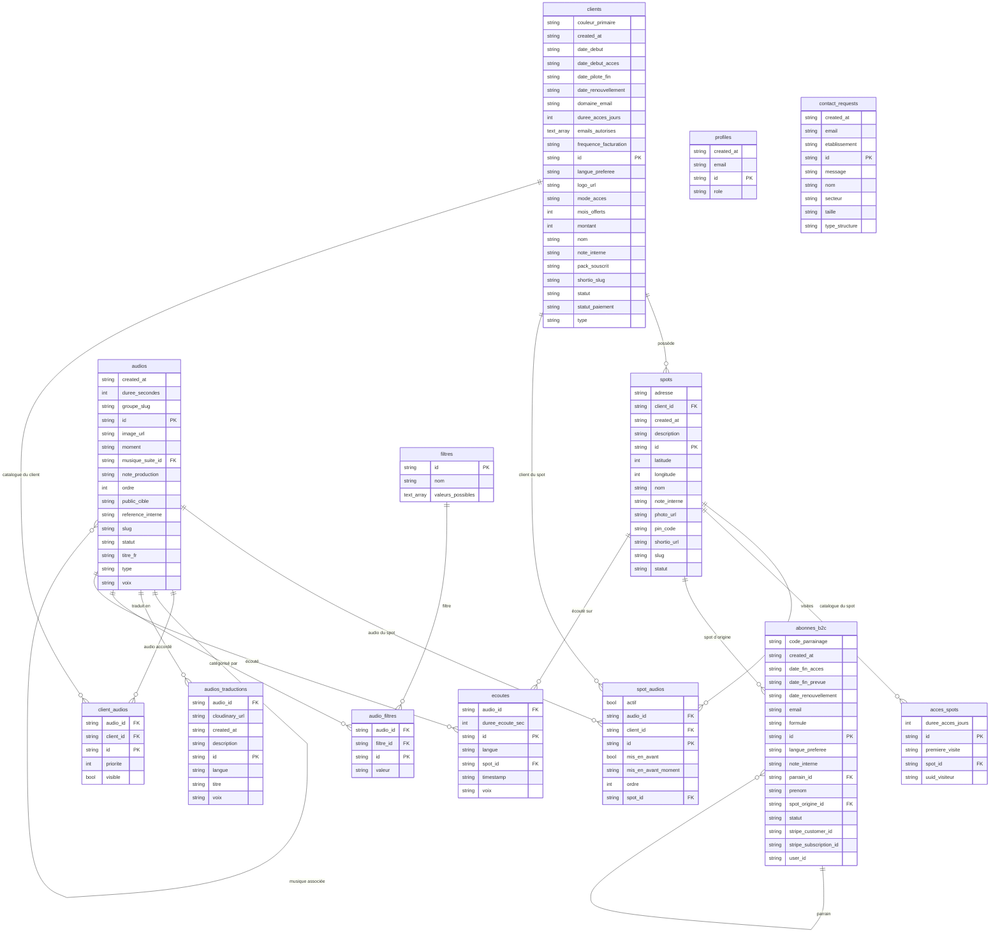

# Schéma ERA — Base de données Spots Zen

> Régénéré le 15/10/2026 à partir de la base réelle (`src/integrations/supabase/types.ts`), après le nettoyage du 15/10 (écoutes anonymes : plus de colonne `user_id` dans `ecoutes`).
> 13 tables. L'état de la RLS table par table est vérifié dans le rapport d'audit sécurité.

## Diagramme de relations

Liens vers les comptes : `profiles.id` et `abonnes_b2c.id` référencent `auth.users.id` (comptes Supabase Auth, non représentés ci-dessus).

## Description des tables

### Cœur B2B
| Table | Rôle |
|---|---|
| `clients` | Établissements partenaires : statut (En attente de paiement · Pilote · Actif · Suspendu), mode d'accès (`qr_libre` ou `email_domaine`), facturation |
| `spots` | Lieux physiques équipés d'un QR code (Short.io), PIN optionnel (`pin_code`, vide = accès libre) |
| `spot_audios` | Audios proposés sur un spot, ordre et mise en avant par moment |
| `client_audios` | Audios visibles ou masqués pour un client (catalogue personnalisé) |
| `acces_spots` | Visites d'un spot par visiteur anonyme (UUID stocké sur l'appareil) et durée d'accès |

### Cœur audio
| Table | Rôle |
|---|---|
| `audios` | Catalogue maître : type, moment, public, durée, statut (`publié` / `brouillon`), musique associée |
| `audios_traductions` | Titre, description, voix (`feminine` · `masculine` · `aucune`) et URL Cloudinary, par langue |
| `filtres` · `audio_filtres` | Filtres de la bibliothèque et leurs valeurs par audio |

### Cœur B2C et suivi
| Table | Rôle |
|---|---|
| `abonnes_b2c` | Abonnés particuliers : statut (`actif` · `paiement_echoue` · `offert` · `ambassadeur` · `inactif` · `resilie`), Stripe, spot d'origine, parrainage, dates de fin |
| `profiles` | Rôle de chaque compte (`admin` ou `user`), utilisé par `is_admin()` |
| `ecoutes` | Écoutes **anonymes** : audio, spot, langue, voix, durée réellement écoutée |
| `contact_requests` | Demandes envoyées depuis le formulaire `/professionnels` |

## Fonctions SECURITY DEFINER

| Fonction | Rôle |
|---|---|
| `is_admin()` | Vrai si `profiles.role = 'admin'` pour l'utilisateur connecté ; utilisée par toutes les règles RLS admin |
| `get_spot_public()` | Infos publiques d'un spot pour la page QR (sans exposer la table) |
| `get_spot_catalog()` | Catalogue d'un spot selon son mode d'accès |
| `get_library_catalog()` | Catalogue de la bibliothèque : abonnés `actif`/`paiement_echoue`, et `offert`/`ambassadeur` **jusqu'à `date_fin_acces`** |
| `get_audio_public()` · `get_public_titles()` | Métadonnées et titres publics des audios |
| `register_spot_visit()` | Enregistre une visite dans `acces_spots` |
| `check_spot_email_domain()` | Vérifie qu'une adresse appartient au domaine du client avant l'envoi du lien |
| `verify_spot_pin()` · `spot_email_ok()` | Anciennes fonctions, accès fermé le 14/10/2026 (toujours présentes dans la base) |

## Règle notable

- `ecoutes` n'accepte que des **ajouts** (aucune modification par les visiteurs), et seulement pour un audio publié : les statistiques ne peuvent pas être trafiquées.
