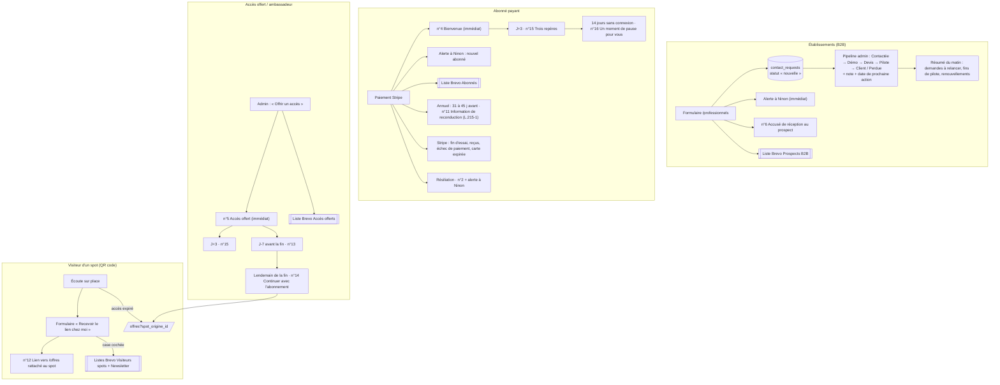

# Tunnel emails et CRM Spots Zen

*16/10/2026 — état préparé avant le lancement. Tous les modèles Brevo sont **inactifs** : rien ne part tant que Ninon ne les active pas et ne met pas `EMAILS_ACTIFS=true` dans Vercel.*

## 1. Schéma des parcours

## 2. Qui envoie quoi

| Moment | Email | Modèle Brevo | Déclencheur | Interrupteur |
|---|---|---|---|---|
| Demande B2B reçue | Alerte interne à Ninon | — (HTML dans le code) | formulaire | `NOTIF_CONTACT_ACTIVE` |
| Demande B2B reçue | Accusé de réception au prospect | n°6 | formulaire | `EMAILS_ACTIFS` |
| Visiteur d'un spot | Lien pour continuer chez soi | n°12 | formulaire du spot | `EMAILS_ACTIFS` |
| Paiement Stripe | Bienvenue | n°4 | webhook Stripe | `EMAILS_ACTIFS` |
| Paiement Stripe / échec / résiliation | Alerte interne à Ninon | — | webhook Stripe | `NOTIF_ABONNES_ACTIVE` |
| Résiliation programmée | Confirmation de résiliation | n°2 | webhook Stripe | `EMAILS_ACTIFS` |
| Accès offert créé | Accès offert | n°5 | admin | `EMAILS_ACTIFS` |
| J+3 après l'inscription | Trois repères | n°15 | robot quotidien | `EMAILS_ACTIFS` |
| 14 jours sans connexion | Un moment de pause pour vous | n°16 | robot quotidien | `EMAILS_ACTIFS` |
| Fin d'accès offert − 7 jours | Encore une semaine | n°13 | robot quotidien | `EMAILS_ACTIFS` |
| Lendemain de la fin d'accès offert | Continuer avec Spots Zen | n°14 | robot quotidien | `EMAILS_ACTIFS` |
| Annuel, 31 à 45 j avant le renouvellement | Information de reconduction | n°11 | robot quotidien | `EMAILS_ACTIFS` |
| Chaque matin, s'il y a quelque chose | Résumé pour Ninon | — | robot quotidien | `NOTIF_RESUME_ACTIVE` |
| Fin d'essai, reçus, échec de paiement, carte expirée | Emails Stripe | Stripe | Stripe | réglages Stripe |

Le **robot quotidien** est la route `/api/public/cron/quotidien`, appelée chaque jour à 6 h UTC (7 h ou 8 h à Paris) par Vercel Cron (`vercel.json`). Elle est protégée par `CRON_SECRET` : Vercel envoie automatiquement l'en-tête `Authorization: Bearer <CRON_SECRET>`.
Chaque envoi est inscrit dans `emails_automatiques` avec une clé unique : un même email ne peut pas partir deux fois. Le journal est visible dans l'admin, onglet « Emails ».
Tant que `EMAILS_ACTIFS` ≠ `true`, le robot tourne en **simulation** : il calcule ce qui partirait, n'envoie rien et n'écrit rien.

## 3. Langues

Chaque email existe en 5 langues dans Brevo (tous inactifs). `src/lib/brevo.server.ts` → `MODELES` :

| Email | FR | EN | DE | NL | ES |
|---|---|---|---|---|---|
| Bienvenue | 4 | 21 | 22 | 23 | 24 |
| Résiliation | 2 | 17 | 18 | 19 | 20 |
| Accès offert | 5 | 25 | 26 | 27 | 28 |
| Accusé de réception B2B | 6 | 29 | 30 | 31 | 32 |
| Accès offert J-7 | 13 | 33 | 34 | 35 | 36 |
| Accès offert terminé | 14 | 37 | 38 | 39 | 40 |
| Accueil J+3 | 15 | 41 | 42 | 43 | 44 |
| Relance inactivité | 16 | 45 | 46 | 47 | 48 |
| Rappel annuel L.215-1 | 11 | 49 | 50 | 51 | 52 |
| Visiteur spot | 12 | 53 | 54 | 55 | 56 |

La langue est celle choisie dans la bibliothèque (`abonnes_b2c.langue_preferee`, enregistrée à chaque visite), celle du site pour un formulaire, ou celle choisie par Ninon pour un accès offert. Les dates et le prix sont écrits dans la langue de l'email (« 14 November 2026 », « €49 »). Une langue inconnue retombe sur le français.
Les 4 emails d'accompagnement (J-7, fin d'accès, J+3, relance) portent la ligne « Répondez STOP » ; la case « A répondu STOP » de la fiche abonné les coupe.
Sources des traductions : `docs/emails/traductions/` (textes et script de génération).

## 4. Mise en service (dans cet ordre)

1. Supabase → SQL Editor : exécuter `supabase/migrations/20261016090000_tunnel_emails_crm.sql`.
2. Brevo → Contacts → Listes : créer « Abonnés », « Accès offerts », « Prospects B2B », « Visiteurs spots », « Newsletter » et noter leurs numéros.
3. Vercel → Settings → Environment Variables : `CRON_SECRET` (longue chaîne aléatoire), `BREVO_LISTE_ABONNES`, `BREVO_LISTE_ACCES_OFFERTS`, `BREVO_LISTE_PROSPECTS_B2B`, `BREVO_LISTE_VISITEURS_SPOTS`, `BREVO_LISTE_NEWSLETTER`, puis `BREVO_SYNC_ACTIF=true`, `NOTIF_ABONNES_ACTIVE=true`, `NOTIF_RESUME_ACTIVE=true` quand Ninon le décide.
4. Pousser le code, redéployer.
5. Test sans envoi : `curl -H "Authorization: Bearer <CRON_SECRET>" "https://spotszen.fr/api/public/cron/quotidien?simulation=1"`.
6. Au lancement : activer les modèles dans Brevo, puis `EMAILS_ACTIFS=true`.

## 5. Sources

- Code de la consommation, art. L.215-1 (information avant reconduction tacite : « au plus tôt trois mois et au plus tard un mois avant le terme », date limite de non-reconduction dans un encadré apparent) — Légifrance : https://www.legifrance.gouv.fr/codes/article_lc/LEGIARTI000034072591/ (lien à reconfirmer sur Légifrance, la page n'a pas pu être ouverte depuis l'outil)
- Code des postes et des communications électroniques, art. L.34-5 (consentement préalable à la prospection par email, exception « produits ou services analogues » pour les clients, opposition simple et gratuite) — fiche pratique CCI Paris Île-de-France : https://www.entreprises.cci-paris-idf.fr/fiches-pratiques/prospection-commerciale-par-voie-electronique
- Vercel, « Securing cron jobs » (CRON_SECRET envoyé dans l'en-tête Authorization), « Cron jobs accuracy » (Hobby : une fois par jour, à n'importe quel moment de l'heure prévue), « delivery and idempotency » (passage manqué ou doublé possible, d'où la clé unique) : https://vercel.com/docs/cron-jobs/manage-cron-jobs
- Brevo API, créer ou mettre à jour un contact (`updateEnabled`) : https://developers.brevo.com/reference/createcontact
